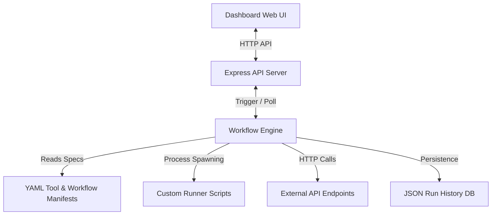

# ⚡ ToolFlow: Workflow Automation Engine for Custom Tools

ToolFlow is a powerful, developer-centric workflow automation engine designed specifically to wrap, chain, and monitor custom system scripts (Python, Node.js, Shell) and HTTP APIs from a unified, modern web dashboard.

This framework allows developers, DevOps engineers, and QA automation specialists to transform disjointed utilities into structured, validated pipelines with real-time log streaming and execution history.

---

## 🏗️ Architecture



---

## 🚀 Key Features

- **YAML-Defined Manifests**: Define your custom scripts and API endpoints with strict input validations (types, requirements, defaults).
- **Orchestration & Chaining (DAG)**: Pass outputs from previous steps as inputs to downstream steps using dynamic variables: `${steps.step_id.outputs.output_name}`.
- **Asynchronous Execution**: Workflows run non-blocking in the background, updating live states to disk.
- **Live Terminal & Console Stream**: Real-time console logger with scroll locking in the UI dashboard.
- **Visual Execution Timeline**: Inspect step durations, statuses (Success, Running, Failed), and step-specific output payloads.
- **Minimalist Core & Glassmorphism Design**: High-performance, self-contained architecture utilizing native Node.js core modules.

---

## 🛠️ Project Structure

```text
├── config/
│   ├── tools/            # YAML tool schema definitions
│   │   ├── system_info.yaml
│   │   └── http_ping.yaml
│   └── workflows/        # YAML workflow pipeline definitions
│       └── health_check_alert.yaml
├── public/               # Web Dashboard frontend files
│   ├── index.html
│   ├── styles.css
│   └── app.js
├── scripts/              # Custom runner scripts executed by tools
│   └── system_info.js
├── tests/                # Automated engine verification suite
│   └── engine.test.js
├── runs/                 # Local execution database (Git ignored)
├── engine.js             # Core workflow execution engine
├── server.js             # Express API server hosting dashboard and APIs
├── package.json          # Node dependencies and scripts
└── README.md
```

---

## 💻 Getting Started

### Prerequisites

- [Node.js](https://nodejs.org/) (v16 or higher)

### Setup & Installation

1. Clone the repository and navigate to the project directory:
   ```bash
   git clone https://github.com/MelvinjoseC/Automation-on-coustem-tools.git
   cd "Automation on coustem tools"
   ```

2. Install dependencies:
   ```bash
   npm install
   ```

3. Run the automated tests to verify the engine:
   ```bash
   npm test
   ```

4. Start the local development server:
   ```bash
   npm start
   ```

5. Open your browser and navigate to:
   ```text
   http://localhost:3000
   ```

---

## ✍️ How to Add a Custom Tool

To add a new custom CLI script, follow these two simple steps:

### 1. Create the Script
Create a script in the `scripts/` folder, for example `scripts/disk_cleanup.js`. It should output its result payload as a **JSON string** to stdout:
```javascript
// scripts/disk_cleanup.js
console.log(JSON.stringify({
  cleaned: true,
  freedBytes: 104857600
}));
```

### 2. Define the Manifest
Create a matching configuration manifest in `config/tools/disk_cleanup.yaml`:
```yaml
name: disk_cleanup
description: Trigger custom automated directory purging
type: script
scriptPath: scripts/disk_cleanup.js
inputs:
  - name: targetPath
    type: string
    required: true
outputs:
  - name: cleaned
    type: boolean
  - name: freedBytes
    type: number
```

---

## 🔗 Chaining Workflows

Create workflow pipelines inside `config/workflows/` using standard YAML arrays. You can pass inputs dynamically:

```yaml
name: system_hygiene
description: Run disk cleanup and alert external endpoint
steps:
  - id: run_cleanup
    tool: disk_cleanup
    inputs:
      targetPath: "/tmp"
  - id: send_notification
    tool: http_ping
    inputs:
      url: "https://httpbin.org/get?freed=${steps.run_cleanup.outputs.freedBytes}"
```
