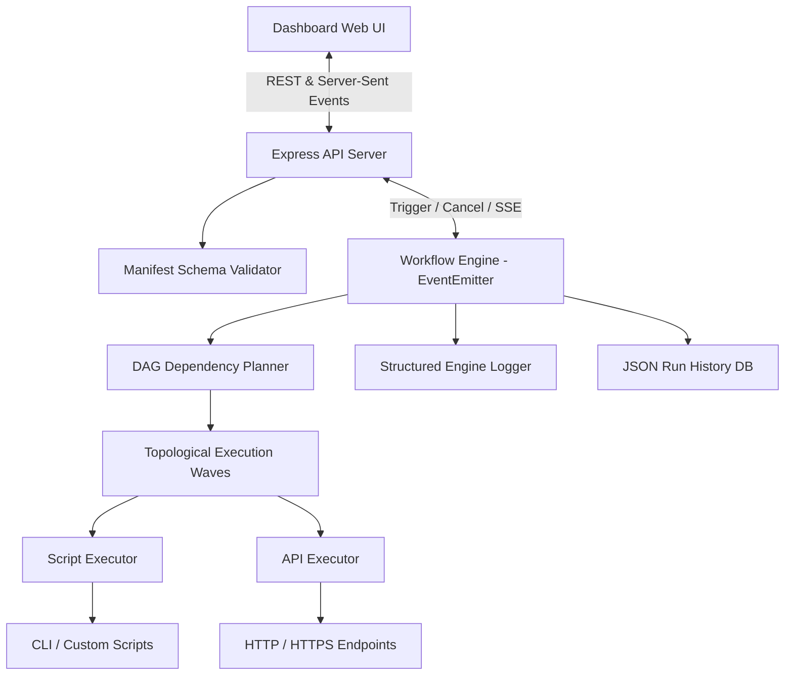

# ⚡ ToolFlow: Workflow Automation Engine for Custom Tools

ToolFlow is an enterprise-grade, developer-centric workflow automation engine designed specifically to wrap, chain, and monitor custom system scripts (Node.js, Python, Shell) and HTTP APIs from a unified, modern web dashboard.

This framework allows developers, DevOps engineers, and QA automation specialists to transform disjointed utilities into structured, validated pipelines with real-time log streaming (SSE), DAG parallel execution, and execution history.

---

## 🏗️ Architecture (v2)



---

## 🚀 Key Features

- **YAML-Defined Manifests**: Define custom scripts and API endpoints with strict schema validations (types, requirements, defaults).
- **DAG Dependency Planning & Parallelism**: Model multi-stage pipelines with `dependsOn` arrays. Independent steps run in parallel topological waves.
- **Advanced Expression Evaluator**: Dynamic interpolation of `${workflow.inputs.key}`, `${steps.id.outputs.key}`, `${env.VAR}`, and conditional expressions with `<, <=, >, >=, ==, !=, &&, ||`.
- **Real-Time Log Streaming (SSE)**: Live Server-Sent Events stream (`/api/runs/:runId/stream`) with zero-latency log delivery and smart UI scroll lock.
- **Event-Driven Core (`EventEmitter`)**: Decoupled engine architecture emitting structured lifecycle events (`workflow:start`, `step:start`, `step:success`, `step:retry`, `run:cancel`).
- **Resilience & Execution Constraints**: Step-level timeouts, automated retry policies with configurable exponential backoff delays, and user cancellations.
- **Enterprise Security**: Input sanitization against path traversal, IP rate limiting, and HTTP security headers (`nosniff`, `SAMEORIGIN`).
- **Production Observability**: Built-in `/api/health` system probes, `/api/metrics` telemetry, and in-browser log search/level filtering with JSON run exports.
- **Containerized Deployment**: Multi-stage `Dockerfile` and `docker-compose.yml` with non-root security and automated healthchecks.

---

## 🛠️ Project Structure

```text
├── .github/workflows/
│   └── ci.yml               # GitHub Actions CI matrix test runner
├── config/
│   ├── tools/               # YAML tool schema definitions
│   │   ├── system_info.yaml
│   │   ├── http_ping.yaml
│   │   ├── disk_cleanup.yaml
│   │   ├── disk_usage.yaml
│   │   ├── log_analyzer.yaml
│   │   └── webhook_notify.yaml
│   └── workflows/           # YAML workflow pipeline definitions
│       ├── health_check_alert.yaml
│       └── system_diagnostics.yaml
├── lib/
│   ├── dag.js               # DAG Planner & cycle detection
│   ├── evaluator.js         # Expression & conditional evaluator
│   ├── logger.js            # Structured logger with levels
│   ├── validator.js         # Tool & workflow schema validator
│   └── executors/           # Modular tool execution runners
│       ├── index.js
│       ├── scriptExecutor.js
│       └── apiExecutor.js
├── public/                  # Web Dashboard frontend files
│   ├── index.html
│   ├── styles.css
│   └── app.js
├── scripts/                 # Custom runner scripts executed by tools
│   ├── system_info.js
│   ├── disk_cleanup.js
│   ├── disk_usage.js
│   └── log_analyzer.js
├── tests/                   # Automated verification test suites
│   ├── runAll.js            # Master test runner
│   ├── evaluator.test.js    # Expression evaluator unit tests
│   ├── validator.test.js    # Schema validator unit tests
│   ├── dag.test.js          # DAG & concurrency tests
│   └── engine.test.js       # End-to-end engine integration tests
├── Dockerfile               # Production multi-stage Docker container
├── docker-compose.yml       # Container orchestration spec
├── engine.js                # Core workflow execution engine
├── server.js                # Express API server hosting dashboard and APIs
├── package.json             # Node dependencies and scripts
├── .env.example             # Environment variable template
└── README.md
```

---

## 💻 Getting Started

### Prerequisites

- [Node.js](https://nodejs.org/) (v18 or higher)
- [npm](https://www.npmjs.com/) (v9 or higher)

### Setup & Installation

1. Clone the repository and navigate to the project directory:
   ```bash
   git clone https://github.com/MelvinjoseC/Automation-on-coustem-tools.git
   cd Automation-on-coustem-tools
   ```

2. Install dependencies:
   ```bash
   npm install
   ```

3. Run the automated master test suite:
   ```bash
   npm test
   ```

4. Start the local server:
   ```bash
   npm start
   ```

5. Open your browser and navigate to:
   ```text
   http://localhost:3000
   ```

---

## 🐳 Docker Deployment

Run ToolFlow instantly via Docker Compose:

```bash
docker-compose up -d
```

The container automatically mounts `./runs` for log persistence and `./config` for live YAML editing without rebuilding.

---

## 🌐 API Reference

| Method | Endpoint | Description |
|---|---|---|
| `GET` | `/api/health` | System health check, uptime, memory metrics |
| `GET` | `/api/metrics` | Telemetry, run success rate, active workers |
| `GET` | `/api/tools` | List registered custom tools |
| `POST`| `/api/tools/validate` | Validate tool YAML schema |
| `GET` | `/api/workflows` | List registered workflows |
| `POST`| `/api/workflows/validate` | Validate workflow YAML schema & references |
| `POST`| `/api/workflows/:name/dry-run` | Preview DAG waves and dependencies without execution |
| `POST`| `/api/workflows/:name/run` | Trigger workflow execution in background |
| `GET` | `/api/runs` | List execution history |
| `GET` | `/api/runs/:runId` | Get detailed run metadata, steps, and logs |
| `GET` | `/api/runs/:runId/stream` | Server-Sent Events (SSE) real-time log stream |
| `POST`| `/api/runs/:runId/cancel` | Cancel an active workflow run |
| `DELETE`| `/api/runs/:runId` | Delete a historical run record |

---

## 🔗 DAG & Parallel Execution Spec

Declare dependencies between steps using `dependsOn`. Independent steps automatically execute in parallel waves:

```yaml
name: system_diagnostics
description: Multi-stage automated health assessment
steps:
  - id: inspect_system
    tool: system_info

  - id: check_disk
    tool: disk_usage

  # scan_logs and check_disk execute concurrently in Wave 1
  - id: scan_logs
    tool: log_analyzer
    inputs:
      targetPath: "."

  # auto_purge waits for check_disk in Wave 2
  - id: auto_purge
    tool: disk_cleanup
    dependsOn:
      - check_disk
    if: "${steps.check_disk.outputs.usedPercent} > 80"
    inputs:
      targetPath: "/tmp"
```

---

## 🤝 Contributing

Contributions are welcome! Please check out [CONTRIBUTING.md](CONTRIBUTING.md) for details on code style, test requirements, and commit conventions.

---

## 📄 License

ISC License.
